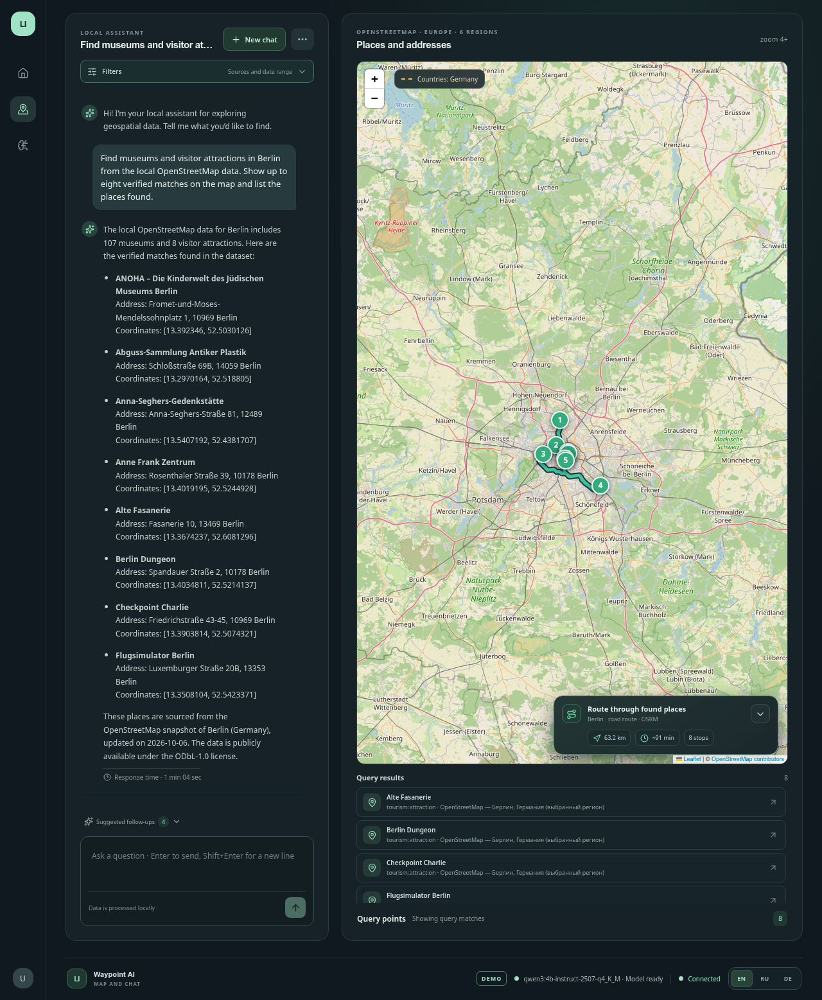

# Waypoint AI

Waypoint AI is a self-hosted geospatial assistant demo. It turns natural-language place and itinerary requests into verified backend searches, then connects the returned places to map highlights and routes.



[](https://github.com/developer-kirill-nefodov/WaypointAI/actions/workflows/ci.yml)

## Why the model can't invent a stop

The assistant can interpret a trip request, but it does not write the final stop list. The backend assembles itineraries from verified place rows already stored in the database. Place names and coordinates come from those rows, while route geometry and distance come from the routing service. When the available data does not contain a matching place, the assistant asks for clarification or reports that no matching stop was found.

The model runs through a locally managed Ollama service. It can request a small allowlist of backend functions; the backend validates each request and queries approved data sources. The model does not receive database credentials, arbitrary SQL, or general internet access.

## What the demo shows

- English, Russian, and German assistant interactions.
- Local inference with an explicit model lifecycle and configurable resource limits.
- Search over imported OpenStreetMap places and clear source coverage metadata.
- Deterministic itinerary stops built from verified place rows, with a route displayed when the configured route service returns one.
- Explicit empty, clarification, model-unavailable, and route-unavailable states.

The included OpenStreetMap extracts cover selected regions in Germany, Poland, Romania, France, Italy, and Spain; coverage is not complete in every country. Synthetic event records are not part of the default demo dataset.

## Architecture

```text
React + Vite
   | HTTP and WebSocket
   v
Express backend --- allowlisted tools --- Sequelize --- PostgreSQL
   |
   +--- Ollama on loopback
   +--- optional routing provider (coordinates only)
```

See the [system workflow](docs/system-workflow.md), [stack decision](docs/stack-decision.md), [backend guide](docs/backend.md), [frontend guide](docs/frontend.md), [model setup](docs/local-model-setup.md), and [demo plan](docs/demo-plan.md).

## Requirements

- Node.js 24 LTS
- Docker Compose
- Ollama runtime and model, installed separately for local inference
- Network access for first-time package, runtime, model, and optional map-data downloads

## Setup

```bash
npm install
cp .env.example .env
docker compose up -d postgres
npm run db:migrate
npm run model:install:local
npm run data:import:europe
```

In one terminal, start the local model server; in another, pull the configured model:

```bash
npm run model:serve
npm run model:pull
```

Then start the app:

```bash
npm run dev
```

The frontend runs at `http://127.0.0.1:5173`; the API health endpoint is `http://127.0.0.1:8000/api/v1/healthz`. Model weights, Ollama runtime files, map extracts, and local environment values are excluded from Git. Setup scripts do not run automatically when the app starts. See [model configuration](docs/local-model-setup.md) for environment settings.

## Data and privacy boundaries

The browser talks only to the backend. The backend is the only component that connects to Ollama and PostgreSQL. Model tool calls are validated, read-only, and bounded. Conversation retention and the single-workspace demo limitations are documented in the [backend guide](docs/backend.md).

OpenStreetMap attribution and source metadata are shown in the app. The optional map tile and routing providers are separate external services; routing sends coordinates only. The demo does not provide user authentication or multi-workspace authorization and should not be used with sensitive data.

## Development checks

```bash
npm run typecheck
npm run build
npm test
```

See [demo rehearsal](docs/demo-rehearsal.md) and [project rules](PROJECT_RULES.md).
