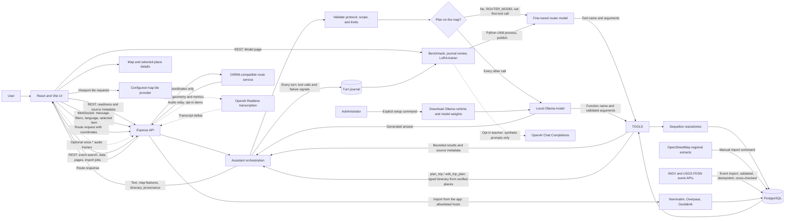

# System workflow

This page describes the current local demo architecture. It is suitable for GitHub Markdown: GitHub renders the Mermaid diagram and the component table below.

## Request flow

## Component table

| Component | Responsibility | Boundary |
|---|---|---|
| React/Vite frontend | Sends chat requests, displays source evidence, results, and map layers | Does not connect to PostgreSQL or Ollama. Map tiles are fetched from the configured tile provider. |
| Express API and WebSocket | Validates requests, reports readiness, streams status and results | Uses the contracts in [`contracts/openapi.yaml`](../contracts/openapi.yaml) and [`contracts/websocket.md`](../contracts/websocket.md). |
| Assistant orchestration | Runs the model-assisted tool flow, builds plans and place lists from rows, and reports each step | Applies the active source/date scope and selected map item context. |
| Router model (optional) | A small fine-tuned model that picks the first tool call from a short prompt (`ROUTER_MODEL`) | Its call is validated like any other; replies, invalid answers, and turns with a plan on the map go to the main model. |
| Ollama model | Interprets open-ended requests and may request an available function | Runs locally. It has no database credentials, SQL access, shell access, or general web-search tool. |
| Allowlisted functions | Searches optional configured records, verified OSM places, and source metadata | Function arguments are validated; queries use repositories and bounded results. |
| Sequelize and PostgreSQL | Stores imported places, source metadata, conversations, and optional records | The model never connects to the database directly. |
| Route service | Returns road geometry and route metrics for verified coordinates | The backend sends coordinates only; it does not send chat text, place names, or IDs. The demo endpoint is not guaranteed. |
| Voice relay (demo, opt-in) | Streams microphone audio to OpenAI transcription and returns live transcript text to the composer | Disabled by default. The backend holds the API key; the browser never contacts OpenAI. Audio and transcripts are not stored or logged. |
| Event importer (demo) | Imports INGV and USGS earthquake events into `records`, matches the two catalogues, links events to nearby places, and records sync runs | Run with `npm run data:import:events` or from the import dialog. HTTPS to allowlisted hosts only; see [technical decisions](technical-decisions.md). |
| Investigation API (demo) | Bounded event search, details, import jobs, and a natural-language query endpoint | The model may call only `search_events`; see [demo and review guide](demo-and-review.md). |
| Area and region importer | Loads places of a city or area (Overpass) or a whole Geofabrik region into its own dataset | Started from the app with `INVESTIGATION_IMPORT_ENABLED=true`; allowlisted hosts, area and file size limits, one heavy job at a time. |
| Training (Model page) | Benchmark runs, the turn journal and its review, LoRA fine-tuning of the router, model export and import | Editing needs `TRAINING_ENABLED`. Training runs locally in a Python child process; the journal stays on this machine and expires after `JOURNAL_RETENTION_DAYS`. |
| Teacher (opt-in) | Writes router training examples in batches for review | Needs `OPENAI_API_KEY`; sends synthetic prompts and settlement names only, with a daily cap. |
| OSM snapshot importer | Imports selected regional place extracts into the local database | Run manually. Snapshot coverage can be incomplete or outdated; retain ODbL attribution. |
| Model setup scripts | Install the local Ollama runtime and pull the configured model | Run manually with `npm run model:install:local`, start the server with `npm run model:serve`, then pull weights with `npm run model:pull`. Model weights and runtime files stay in ignored `data/local/`. |

## Data boundaries

- User text reaches the assistant backend over the WebSocket connection. Only the backend sends the prompt and bounded tool results to the local Ollama process.
- The model can request only the functions declared in the server allowlist. The backend validates arguments and executes the relevant repository operation.
- Place search uses locally imported OpenStreetMap snapshots. The model does not browse the internet.
- Routing is a separate backend request to the configured routing provider. In the demo configuration, that provider may be public and receives route coordinates.
- When voice input is enabled and the user records, microphone audio leaves the machine for OpenAI transcription through the backend. The transcript only fills the composer; the user decides whether to send it.
- When the teacher is used, the backend sends OpenAI synthetic generation prompts and settlement names; chat messages and journal turns are never sent.
- The browser map may request visible tiles from the configured tile provider. These requests do not include chat text or selected place IDs.
- Model runtime files, model weights, local database files, `.env`, imported chat material, and screen recordings must not be committed.

## Related documentation

- [Project setup and model download](../README.md#setup)
- [Backend lifecycle and endpoints](backend.md)
- [Frontend and map integration](frontend.md)
- [Model isolation and limitations](local-model-and-isolation.md)
- [Stack decision and request flow](stack-decision.md)
